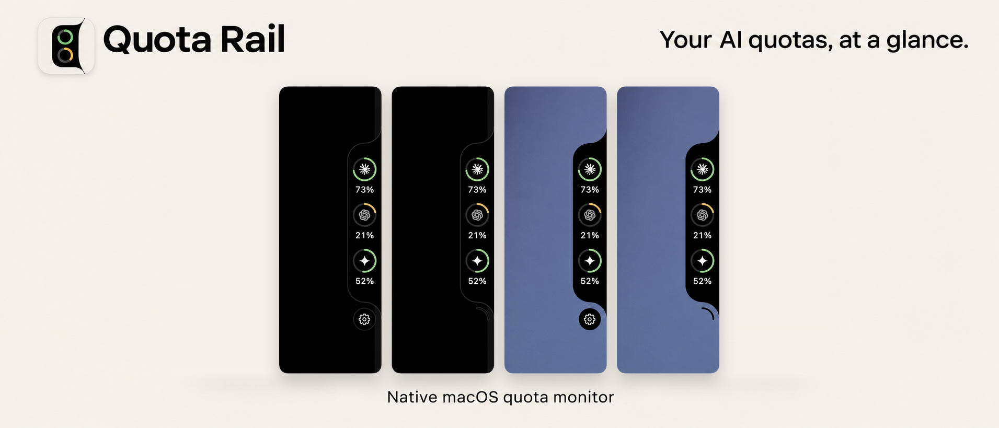
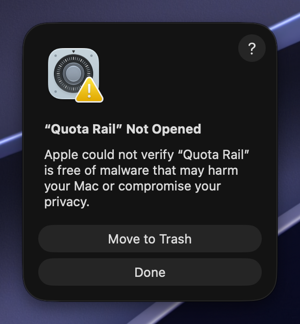
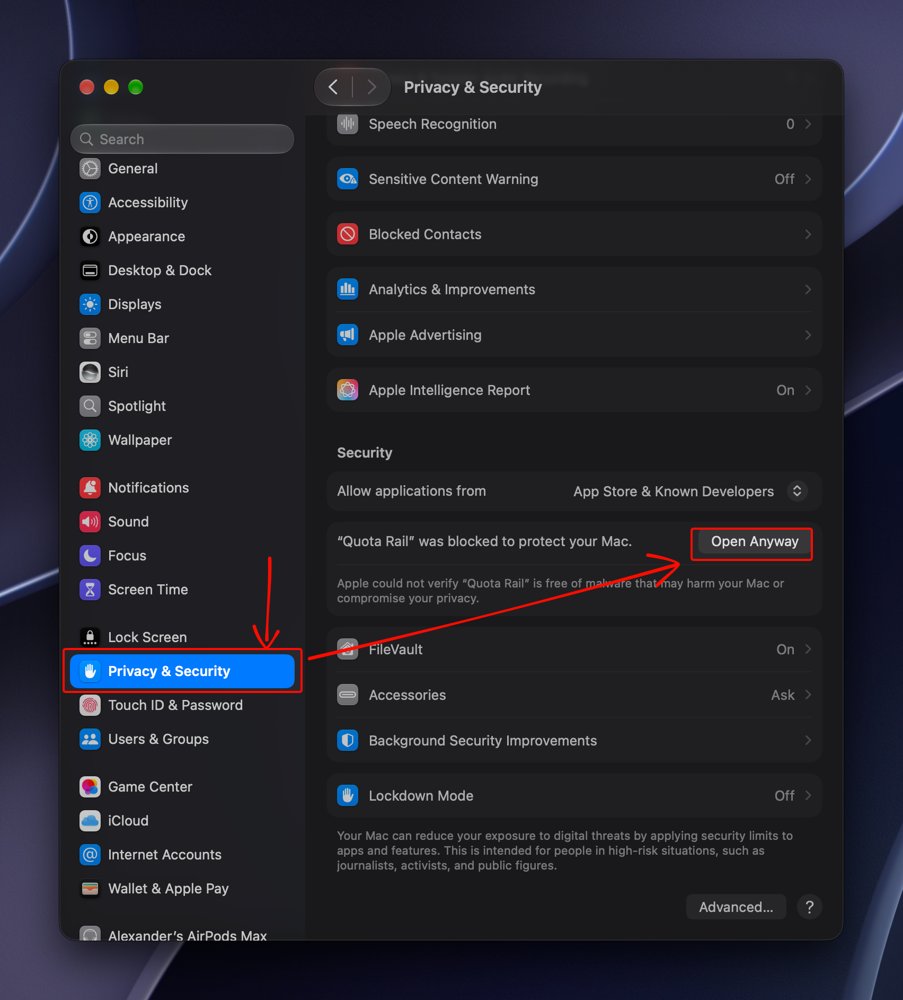
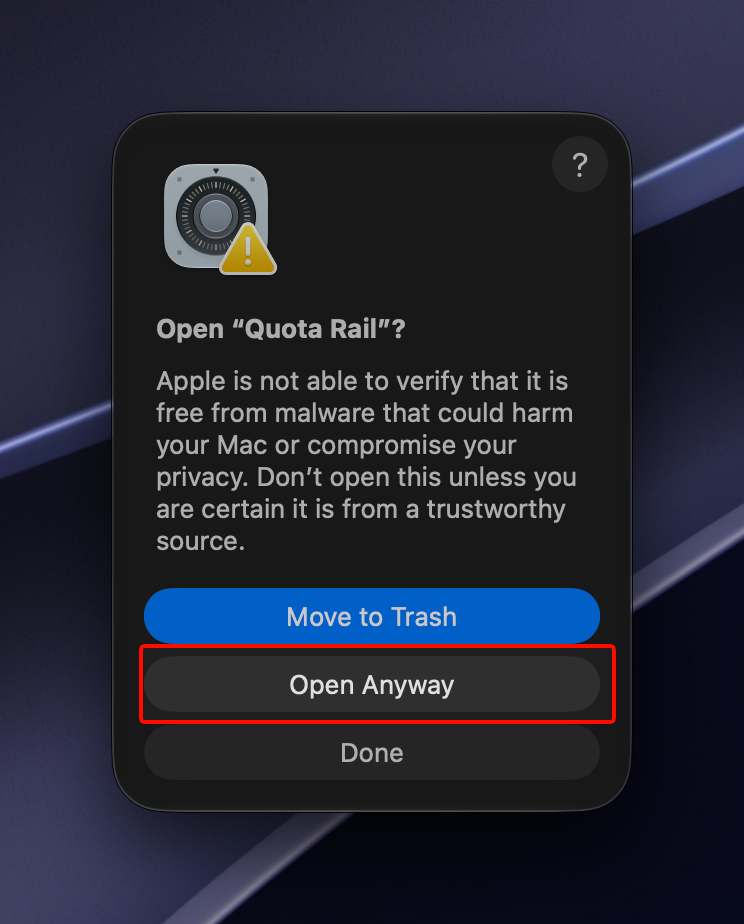
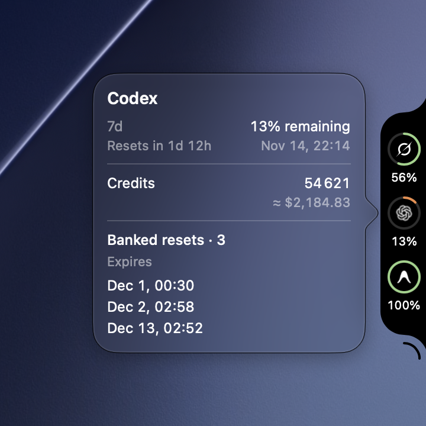
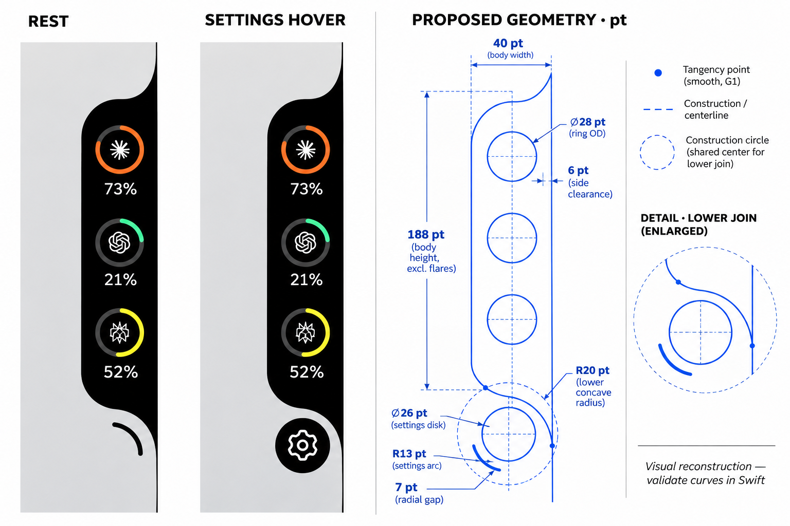

# Quota Rail



A native macOS overlay for checking how much of your AI subscriptions you have left. Hover over the right edge of the screen to reveal your quotas, then click a ring for details.

[Download for Apple Silicon](https://github.com/cododel/quota-rail/releases/latest) · [Installation](#installation) · [Supported subscriptions](#supported-subscriptions) · [Build from source](#development)

## Installation

Requires an Apple Silicon Mac with macOS 14 or later.

1. Download `quota-rail-macos-arm64.zip` from the [latest GitHub release](https://github.com/cododel/quota-rail/releases/latest).
2. Extract the archive, move `Quota Rail.app` to a writable Applications folder, and open it.

### If macOS blocks the first launch

Quota Rail is distributed without Apple notarization, so macOS may show this Gatekeeper warning:

> Apple could not verify “Quota Rail” is free of malware that may harm your Mac or compromise your privacy.

Proceed only if you downloaded the ZIP from the official release linked above and trust the copy you downloaded.

1. Click **Done** in the warning.

   

2. Open **System Settings → Privacy & Security**, scroll to **Security**, and click **Open Anyway** next to the message about Quota Rail.

   

3. In the confirmation dialog, click **Open Anyway** again (or **Open**, depending on the macOS version). Authenticate if prompted.

   

macOS saves an exception for this app. See [Apple's guide to opening apps on your Mac](https://support.apple.com/en-us/102445).

### After opening Quota Rail

Sign in through the CLI for each subscription you want to see. Quota Rail uses those existing sign-ins and shows providers when quota data is available.

On first launch, Quota Rail registers to open automatically when you sign in to macOS. You can turn this off under **System Settings → General → Login Items & Extensions**.

Quota Rail checks for updates on launch. You can also select **Check for Updates** in the gear menu. Confirm installation in the update dialog to let Sparkle verify the download, replace the app, and relaunch it.

If you're upgrading from v0.0.1, quit the old `projector-overlay` process, download the new ZIP once, and open `Quota Rail.app`. Your saved subscription visibility carries over.

### If Adaptive Outline stops working after an update

macOS may still show screen recording access as enabled for the previous build.
If toggling the existing entry does not restore the outline, grant access to the updated app:

1. Quit Quota Rail.
2. In **System Settings → Privacy & Security → Screen & System Audio Recording**, select **Quota Rail** and remove the entry with **−**.
3. Use **+** to add the updated **Quota Rail.app** from Applications and enable access.
4. Open Quota Rail again. If macOS asks you to quit and reopen the app, follow that prompt.

## Supported subscriptions

| Provider | What the overlay shows |
| --- | --- |
| Codex | Available quota windows and reset times, plus credits and banked resets when reported |
| Claude Code | 5-hour and weekly quotas, when reported |
| Antigravity | 5-hour and weekly quotas for Gemini and Claude/GPT |
| Grok Build | Shared weekly quota and reset time |
| OpenCode Go | 5-hour, weekly, and monthly quotas when reported |
| Kimi | Quota windows and reset times from the signed-in Kimi CLI |

Check the release notes for what ships in each download.

## Quota details

Click a ring to see its quota windows and reset times. In the gear menu, choose which subscriptions appear on the rail or keep it expanded.

<p>
  
</p>

## Development

Read the [design specification](docs/DESIGN.md), [agent guide](AGENTS.md),
[engineering guidelines](docs/GUIDELINES.md), and
[development session review](docs/DEVELOPMENT_REVIEW.md) before changing behavior.

Run the Swift watcher from the repository with Bun and the Xcode command line tools installed:

```sh
bun run watch-preview
```

The watcher rebuilds and restarts the overlay when Swift files change. Pass `--full-demo` to start with sample data. In the terminal, press `d` to switch between live and demo quotas, `r` to restart the last successful build, or `s` to suspend and resume the preview. Swift edits made while suspended are rebuilt on resume.

To build once:

```sh
xcrun --sdk macosx swiftc -O -parse-as-library \
  -target arm64-apple-macosx14.0 -module-cache-path cache \
  *.swift -o projector-overlay
./projector-overlay
```

Keep the provider helper scripts and `assets/` next to the executable. The Claude and Antigravity helpers use `/usr/bin/python3`. Source builds and untagged CI builds omit the updater.

For release setup, create a public prerelease tagged `update-feed` and keep its assets mutable. Set the repository variable `SPARKLE_PUBLIC_KEY` and the matching `SPARKLE_PRIVATE_KEY` secret using Sparkle's exported 32-byte seed format. Keep a backup of the private key outside Git. GitHub Actions publishes the ZIP from a stable `vX.Y.Z` tag, verifies the public download, then replaces the signed appcast on `update-feed`. If the ZIP was published but the feed step failed, rerun the macOS workflow with that tag as `release_tag`.

<details>
<summary>Overlay geometry study</summary>



</details>
