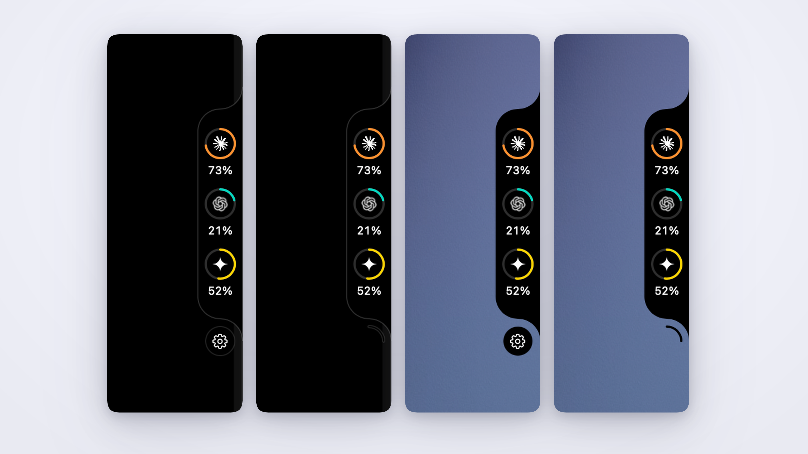
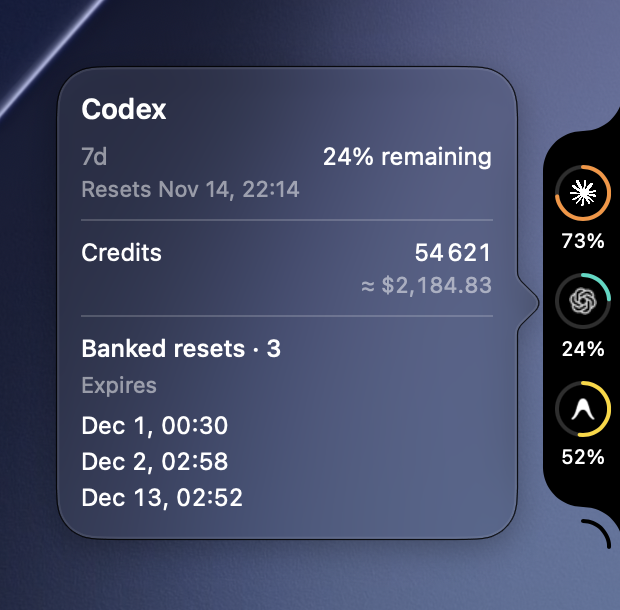

# Quota Rail

A native macOS overlay for checking how much of your AI subscriptions you have left. Hover over the right edge of the screen to reveal your quotas, then click a ring for details.

[Download for Apple Silicon](https://github.com/cododel/quota-rail/releases) · [Supported subscriptions](#supported-subscriptions) · [Build from source](#development)



## Install

Requires an Apple Silicon Mac with macOS 14 or later.

1. Download `quota-rail-macos-arm64.zip` from [GitHub Releases](https://github.com/cododel/quota-rail/releases).
2. Extract the archive, move `Quota Rail.app` to a writable Applications folder, and open it.
3. Sign in through the CLI for each subscription you want to see. Quota Rail uses those existing sign-ins and shows providers when quota data is available.

Quota Rail checks for updates on launch. You can also select **Check for Updates** in the gear menu. Confirm installation in the update dialog to let Sparkle verify the download, replace the app, and relaunch it.

The app is distributed without Apple notarization, so macOS may show a Gatekeeper warning on first launch. If you're upgrading from v0.0.1, quit the old `projector-overlay` process, download the new ZIP once, and open `Quota Rail.app`. Your saved subscription visibility carries over.

## Supported subscriptions

| Provider | What the overlay shows |
| --- | --- |
| Codex | Available quota windows and reset times, plus credits and banked resets when reported |
| Claude Code | 5-hour and weekly quotas, when reported |
| Antigravity | 5-hour and weekly quotas for Gemini and Claude/GPT |
| Grok Build | Shared weekly quota and reset time |

Check the release notes for what ships in each download.

## Quota details

Click a ring to see its quota windows and reset times. In the gear menu, choose which subscriptions appear on the rail or keep it expanded.

<p>
  
</p>

## Development

Run the Swift watcher from the repository with Bun and the Xcode command line tools installed:

```sh
bun watch.mjs
```

The watcher rebuilds and restarts the overlay when Swift files change. Pass `--full-demo` to start with sample data.

To build once:

```sh
xcrun --sdk macosx swiftc -O -parse-as-library \
  -target arm64-apple-macosx14.0 -module-cache-path cache \
  *.swift -o projector-overlay
./projector-overlay
```

Keep the provider helper scripts and `assets/` next to the executable. The Claude and Antigravity helpers use `/usr/bin/python3`. Source builds and untagged CI builds omit the updater.

For release setup, create a public prerelease tagged `update-feed` and keep its assets mutable. Set the repository variable `SPARKLE_PUBLIC_KEY` and the matching `SPARKLE_PRIVATE_KEY` secret using Sparkle's exported 32-byte seed format. Keep a backup of the private key outside Git. GitHub Actions publishes the ZIP from a stable `vX.Y.Z` tag, verifies the public download, then replaces the signed appcast on `update-feed`. If the ZIP was published but the feed step failed, rerun the macOS workflow with that tag as `release_tag`.

<details>
<summary>Overlay geometry study</summary>


</details>
