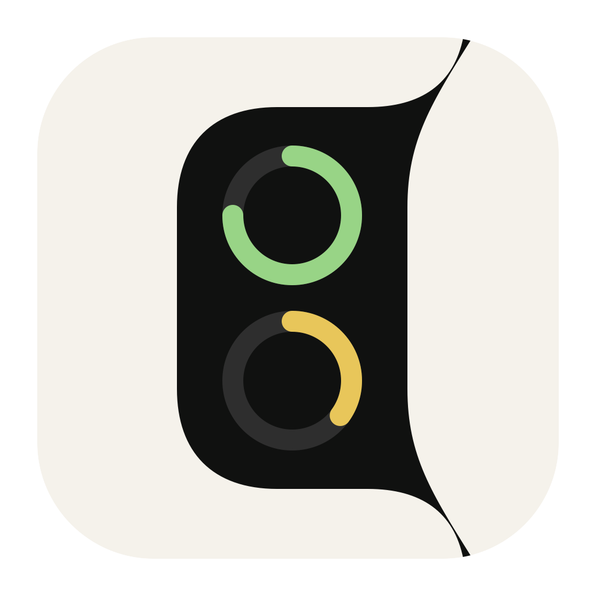
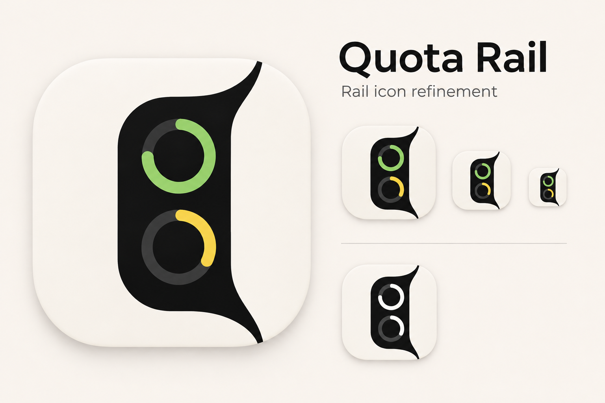
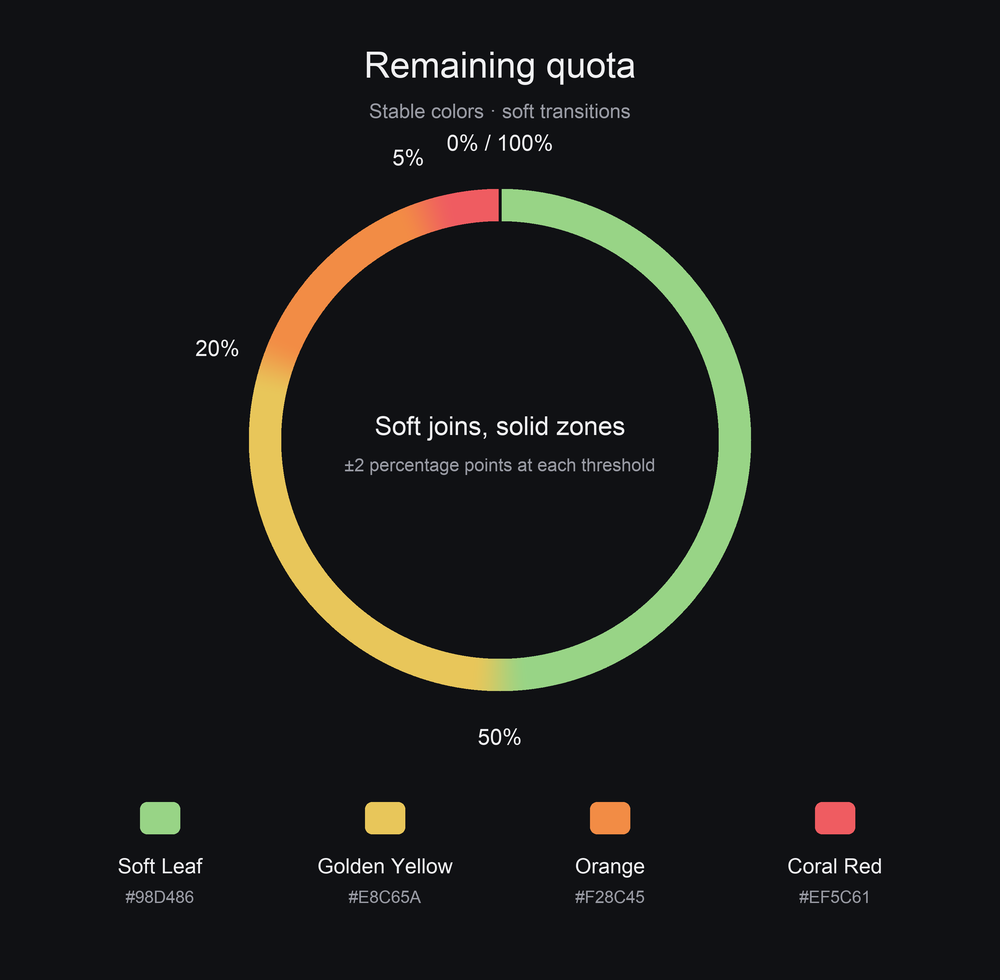
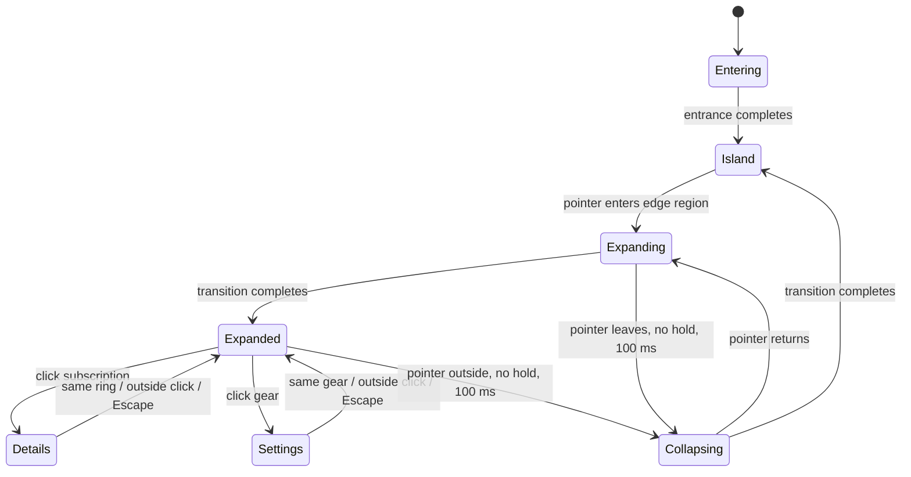

# Quota Rail — Design specification

This document defines the visual concept, interaction states and motion of Quota Rail.
It is written for designers and implementers without requiring access to Swift source.
It owns the project's design rules; [engineering guidelines](GUIDELINES.md) cover data,
packaging and implementation safeguards. Values below describe the accepted design and
current measured layout, not a claim that every interaction has been visually verified.

## Concept

Quota Rail is a small native macOS instrument attached to the right edge of the screen.
It answers “how much quota remains?” at a glance, then reveals details on demand.
It stays present across desktops and fullscreen spaces without becoming a dashboard.

The signature is a black contour that grows from a tiny edge island into a narrow rail.
Its silhouette changes; it does not behave like a rectangular sidebar sliding in or a
scaled screenshot. Rings move with the unfolding shape while keeping their own size.
A quiet radial mark below the rail grows into the settings button when needed.

Three principles govern composition:

- **Identity through the mark, state through color.** White provider logos identify the
  subscription. Ring color communicates the remaining quota, consistently across providers.
- **Progressive disclosure.** The closed island occupies very little space; hover reveals
  percentages; a click reveals quota windows and account details.
- **Compact, deliberate spacing.** Keep rings legible and evenly spaced. Details are dense
  but grouped, with restrained typography rather than a second large percentage headline.

## Application icon

The application identity is **Rail**: an ivory rounded square with a black vertical
rail silhouette, rounded left shoulders and flared right attachments. Two stacked
quota arcs use Soft Leaf (75%) and Golden Yellow (35%), with charcoal remainder tracks.
The mark contains no provider logos, numbers or settings gear. These fixed sample
arcs identify the app; the icon does not display live account state.

The icon is an optical adaptation of the panel, not a miniature screenshot. Its right
edge curves inward and its strokes are heavier for recognition at small sizes.
The tile is `#F5F2EB`, silhouette `#101110`, tracks `#2E2E2E`; arc colors use the
remaining-quota palette below. Keep transparent margins outside the rounded tile.

`assets/quota-rail.svg` is the editable source. Regenerate the 1024 px PNG and
multi-resolution ICNS from the repository root with
`swift -module-cache-path cache scripts/build-icon.swift`. The packaged app declares
`QuotaRail.icns` as its bundle icon. Generated concept studies are not production assets.

### Rail icon study

The approved concept board shows the Rail silhouette at several scales and in
monochrome. Use it as a visual reference for small-size legibility and for how
the shape reads without color. The shipped SVG defines the final geometry and colors.

## Anatomy and geometry

All dimensions are logical macOS points (pt), not display pixels. A 40 pt rail spans
80 backing pixels on a 2× display. Geometry is independent of screen resolution.

| Element | Baseline dimensions |
| --- | --- |
| Expanded rail body | 40 pt wide × 188 pt high for up to three visible subscriptions |
| Extra subscriptions | Add 54 pt of body height per subscription beyond three |
| Ring centerline diameter | 26 pt |
| Ring stroke | 2 pt, round ends; outer visible diameter 28 pt |
| Horizontal clearance around ring ink | 6 pt on each side |
| Ring + percentage group | 40 × 44 pt; 4 pt gap; percentage line box 14 pt high |
| Group center spacing | 54 pt |
| Settings disk | Diameter 26 pt; interaction area 40 × 40 pt |
| Settings arc | Radius 13 pt; 2 pt round stroke; upper-right quarter at rest |
| Collapsed island | 3 pt deep, central body span 24 pt plus small end flares |
| Collapsed hover region | Rightmost 3 × 48 pt, centered vertically on the island |

The rail is centered vertically in its host area. Groups are centered as a stack.
One or two subscriptions retain the baseline body height; they do not stretch the rings.
Four to six subscriptions lengthen the body, keeping the same ring sizes and pitch.
The settings center moves with the bottom bend. Six connectors are supported; larger
counts need a deliberate fit/overflow design, not automatic shrinking.

### Reconstructing the expanded contour

Use a coordinate system with the body top-left at `(0, 0)`, downward-positive Y,
body height `H`, and the physical screen edge at `x = 40`.

| Segment | Geometry |
| --- | --- |
| Top edge attachment | Concave quarter-circle from `(40, −20)` to `(20, 0)`, center `(20, −20)` |
| Upper shoulder | Convex quarter-circle from `(20, 0)` to `(0, 20)`, center `(20, 20)` |
| Outer side | Vertical line from `(0, 20)` to `(0, H − 20)` |
| Lower shoulder | Convex quarter-circle to `(20, H)`, center `(20, H − 20)` |
| Bottom edge attachment | Concave quarter-circle to `(40, H + 20)`, center `(20, H + 20)` |
| Screen edge | Close the shape vertically along `x = 40` |

All four bends have radius 20 pt and matching tangents at their joins. There are no
visible straight ledges between the paired curves. If using cubic Bézier curves,
quarter-circle control length is `radius × 4(√2 − 1)/3` (approximately `radius × 0.552285`).

The settings disk and arc share center `(20, H + 20)` with the bottom concave bend.
The disk has a 7 pt radial gap to that bend; the arc's outer ink has a 6 pt gap.
The resting arc runs from the top of its circle clockwise to its rightmost point.

## Color system

The rail remains black on both light and dark desktops. It does not switch to a light
surface. Popovers use native macOS material and chrome, so their appearance can vary
with the system and background. Do not invent a fixed popover background hex or radius.

| Role | Color / opacity |
| --- | --- |
| Rail, settings arc and disk | Black `#000000` |
| Provider marks and primary text | White `#FFFFFF`; preserve the supplied OpenCode mark's internal detail |
| Empty ring track | White at 18% over black (approximately `#2E2E2E`) |
| Secondary text | Native secondary foreground treatment |
| Adaptive outline | Light gray, approximately `#D9D9D9`, 1 pt |
| Rail outline opacity | 20% |
| Settings arc/disk outline opacity | 15% |

### Remaining-quota palette

| Name | sRGB hex | Solid-color interval |
| --- | --- | --- |
| Soft Leaf | `#98D486` | 52–100% |
| Golden Yellow | `#E8C65A` | 22–48% |
| Orange | `#F28C45` | 7–18% |
| Coral Red | `#EF5C61` | 0–3% |

There are nominal thresholds at 50%, 20% and 5%. Each has a four-percentage-point
transition band: **48–52%, 18–22%, 3–7%**. Inside a band, blend its two adjacent colors;
outside, keep the color constant. The endpoints 0% and 100% never blend into each other.

For an exact reproduction, let `u = (remaining − lower edge) / 4` within each band.
Use `s = u²(3 − 2u)` and interpolate each encoded sRGB channel from the lower-quota
color to the higher-quota color by `s`. This gives flat joins at both ends of the band.
At 50%, for example, blend Golden Yellow and Soft Leaf equally.

This diagram maps percentages to color; **the widget itself is not a multicolor ring**.
Every filled arc uses one solid color selected from its displayed remaining percentage.
The arc starts at 12 o'clock, runs clockwise, and covers `remaining / 100` of the circle.
At 0% only the empty track remains; at 100% the ring is full. Neither color nor arc length
may refer to a different quota window than the number beneath it.

### Contrast adaptation

On a dark background, add the subtle outline to separate black from black. The current
contrast behavior enables it below 2:1 against black and disables it at 2.5:1 or above;
the gap prevents flickering near the threshold. The overlay itself is excluded from
background measurement. The arc outline follows the full stroke, including round ends.

No contrast numbers appear in ordinary settings. If screen access is required, explain
that it enables **Adaptive Outline**. It must not sound like permission to read quotas.
This outline is visual separation, not a claim of text-accessibility contrast compliance.

## Typography and logos

Use the native system sans-serif. Use monospaced digits for changing percentages,
credit amounts and expiration lists so numbers do not cause horizontal jitter.

| Role | Size and weight |
| --- | --- |
| Percentage beneath ring | 10 pt, regular |
| Details provider heading | 14 pt, semibold |
| Details body / quota values | 12 pt, regular |
| Details group heading / bank count | 12 pt, medium |
| Reset dates, credit estimate, secondary labels | 11 pt, regular |
| Settings section heading | 12 pt, medium |
| Settings plan / unavailable label | 11 pt, secondary |
| Other settings controls | Native control typography |
| Gear symbol | 13 pt at full reveal |

Provider marks are recognizable, monochrome and have no background tiles. Codex uses
the GPT mark; Antigravity uses its own mark, not Gemini's star. Most marks fit a 14 pt
box; OpenCode and Kimi use 11 pt to balance their visual weight. Optical consistency
matters more than identical bounding boxes. Asset attribution lives in
[assets/SOURCES.txt](../assets/SOURCES.txt).

## Interaction states

- Hover reveals the rail. A ring click opens details without further widening the rail.
- Opening settings closes details; selecting a ring closes settings. Only one popover
  is active. Selecting another ring moves the detail context to that subscription.
- A repeat click closes the active popover once, without a flash or immediate reopening.
  Outside clicks, including another application, and Escape close it. Inside clicks
  remain usable. Leaving the rail alone does not close an open popover.
- Keep the rail open while a popover is open, the pointer is over its active region or
  settings control, or **Keep overlay visible** is enabled. Otherwise schedule collapse.
- The gear remains an arc until hovered. While settings are open it remains a disk.
  Its hover and click handling are disabled until expansion completes and disabled
  immediately when collapse begins.
- Entrance must finish before edge hover can trigger expansion. A canceled hover or
  obsolete animation completion must not trigger a later surprise opening.

## Motion language

All custom transitions share **cubic-bezier(0.22, 0, 0.18, 1)**: a gentle start followed
by a long, soft settle. There is no spring bounce or overshoot. Native popover window
presentation remains system-controlled; the custom timing table describes the rail.

| Transition | Duration | Delay / condition |
| --- | --- | --- |
| Dot emerges from screen edge | 420 ms | On appearance |
| Dot morphs into micro-island | 580 ms | After emergence finishes |
| Rail expands | 480 ms | Edge hover; after entrance |
| Rail collapses | 360 ms | 100 ms outside, unless held open |
| Settings arc ↔ disk | 360 ms | 50 ms sustained hover to reveal; no reveal if pointer leaves early |
| Adaptive outline appears/disappears | 200 ms | Contrast-state change |
| Quota arc/color update | 360 ms | Displayed remaining value changes |

### Entrance choreography

A 6 × 6 pt dot starts outside the screen. It emerges until half is visible (3 pt deep),
then the same contour stretches into the micro-island. Do not fade in a finished island
or independently scale its content. The two phases run sequentially.

### Expansion choreography

The silhouette first grows outward, then lengthens vertically. Rings remain full size,
move in from beyond the edge and spread into their regular slots. Clip them to the
changing contour; do not use a ring opacity fade or reveal stationary content solely
through a growing mask. The settings control travels to the lower bend with the rail.

For matching the current shape rhythm, take eased expansion progress `p` from 0 to 1:

- depth follows `3 + 37 × (1 − (1 − p)²)` pt;
- body height follows `24 + (H − 24) × p²` pt;
- full-size ring groups move from 48 pt outside to their final horizontal position;
- vertical group pitch moves from 8 pt to 54 pt around the stack center.

### Settings choreography

At rest the quarter arc is visible. During reveal it extends toward a full circle and
fades out while the black disk grows around the same center. The gear scales with the
disk, not at a fixed size inside it. A short fade hides the glyph at tiny sizes: with
reveal progress `a`, its scale is at least 0.35, and opacity rises from 0 to 1 between
`a = 0.3` and `a = 0.6`. Reverse the same transition on exit. A press brightens the
control subtly; it does not change the geometry.

**Reduce Motion:** skip custom animated travel and interpolation, retaining the same
final geometry, readable values and available controls. Color is reinforced by the
numeric percentage and arc length. Give rings accessible provider/remaining labels,
label the settings action, and hide collapsed controls from accessibility navigation.

## Popovers and information density

Popovers open to the left of the rail. Their arrow touches the rail at the vertical
center of the selected ring or gear, with no floating horizontal gap. Size the final
content before positioning; it must not jump sideways or stretch to screen width.

### Subscription details

The details content is 206 pt wide with 12 pt padding per side (230 pt content footprint,
excluding native chrome). Use 8 pt between sections, 2 pt between a quota line and its
reset date, and 18 pt expiration rows. Separate information groups with native dividers.

Reading order:

1. Provider name.
2. Available quota windows: compact window label at left, remaining value at right,
   subdued countdown at left and exact reset date at right on the line below.
   Use at most two time units. Refresh the countdown every minute while details are
   open. Show **Awaiting refresh** once the reported reset time has passed.
   Antigravity has Gemini and Claude/GPT sections.
3. Credits, only when supplied: rounded displayed balance, approximate dollar estimate
   as a secondary line. Never imply the estimate is a guaranteed cash balance.
4. Banked resets, only when supplied: count, then a compact expiration list with date
   and time together. Up to six records fit without scrolling; longer lists use a
   108 pt scroll area. Missing expiration details remain explicit.

Dates use short month/day and 24-hour time; include the year when it differs from the
current year. Their time zone follows the device's local display convention. Keep the
remaining value readable but do not make it a second large hero metric.

### Settings

Settings content has a fixed 268 pt inner width plus native outer padding. Use 12 pt
between major sections. Subscription rows are 20 pt high with 4 pt spacing. The list
may scroll; the panel must not expand horizontally for a long plan name.

Each row contains a checkbox and provider name on the left, a known plan on the right.
An unknown plan leaves that space blank. With an account but no quota, show **No quota**
and disable the checkbox. Keep protocol/install/auth diagnostics out of this normal UI.

The menu also contains **Keep overlay visible**, eligible release update controls,
conditional demo/screen-access controls, and **Quit** at the bottom after a divider.
The engineering guidelines own which modes expose those conditional controls.
When bundle version metadata is available, show the current version as a muted
10 pt label in the top-right corner of the popover, prefixed with `v`.
Source previews without bundle version metadata show **Preview** in the same spot.

## Empty, unavailable and demonstration states

- While checking, settings says **Checking providers…**. If no signed-in CLI is found,
  it says **No signed-in CLIs found**. An account with no quota remains a disabled row.
- With no available quota, the rail shows a neutral dash rather than a fabricated number.
  Hiding all available subscriptions still leaves settings reachable; do not insert mocks.
- Full demo uses the same shapes, palette, typography and interactions as real data and
  displays all implemented connectors. It is a deliberate preview mode, not a fallback.
- No loading/error state introduces a new status color into the remaining-quota palette.
  Detailed data and mode semantics remain in [GUIDELINES.md](GUIDELINES.md).

## Review checklist

- Compare zero, one, three and six rings at actual size, on light and dark desktops.
- Check the ring/label grouping, optical logo sizes, lower arc alignment and gear growth.
- Check entrance, reversals, early pointer departure, delayed gear hover and Reduce Motion.
- Click each ring and gear twice; check outside-app dismissal and arrow alignment.
- Check threshold neighbors and endpoints: 0, 3, 5, 7, 18, 20, 22, 48, 50, 52 and 100%.
- Keep the displayed percentage, arc length and selected color tied to the same window.
- Check dense details and unavailable rows without widening the popover.

## Evidence and maintenance

The concept and behavior come from the approved development conversation, summarized in
[DEVELOPMENT_REVIEW.md](DEVELOPMENT_REVIEW.md), including the later approved color study.
The numeric baseline was checked against the current rail, details, popover, contrast,
geometry, motion and palette implementations. Source pointers for maintainers:
[main.swift](../main.swift), [OverlayGeometry.swift](../OverlayGeometry.swift),
[OverlayMotion.swift](../OverlayMotion.swift), [QuotaPalette.swift](../QuotaPalette.swift),
[CodexDetails.swift](../CodexDetails.swift), [IndicatorPopover.swift](../IndicatorPopover.swift),
[ContrastMonitor.swift](../ContrastMonitor.swift).

The palette diagram is a deterministic illustration of the approved mapping. Existing
README showcase/details images and the early geometry study are historical: they may
show provider-specific colors or old logos and do not override this specification.
Native typography, popover material and chrome can vary by macOS version; unspecified
platform values are intentionally not invented here. This documentation pass did not
perform a new live visual/accessibility audit. Exact layout measurements are the current
baseline, not a prohibition against a later explicitly approved design adjustment.
